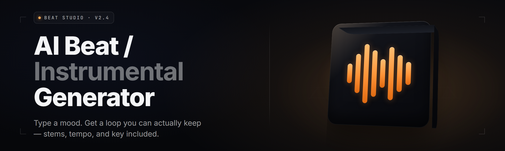

  
  
  

  

  
  
  

---

**AI beat generator for Windows — type a vibe, get a mastered instrumental in seconds. 2026 release.**

  

---

## 🎛️ Table of Contents

- [Overview](#️-overview)
- [🎧 Beat Generation Modules](#-beat-generation-modules)
- [🎚️ Mix & Master Engine](#️-mix--master-engine)
- [🧠 Mood & Genre Engines](#-mood--genre-engines)
- [🎹 Melody & Harmony Tools](#-melody--harmony-tools)
- [📤 Export & Distribution](#-export--distribution)
- [🖥️ Compatibility & Platform Support](#️-compatibility--platform-support)
- [🤔 What is an AI Beat Instrumental Generator?](#-what-is-an-ai-beat-instrumental-generator)
- [📦 Installation](#-installation)
- [🎯 Quick Start](#-quick-start)
- [🧾 All Modules Status](#-all-modules-status)
- [💡 Tips for Best Results](#-tips-for-best-results)
- [🎼 Key Features](#-key-features)
- [⚖️ Comparison](#️-comparison)
- [🛠️ The Solution](#️-the-solution)
- [🐞 Known Issues](#-known-issues)
- [❓ FAQ](#-faq)

---

## 🎛️ Overview

ai-beat-instrumental-studio is a desktop `.exe` that turns text prompts and short audio seeds into finished instrumentals: drum patterns, basslines, chord beds, motifs, and a mixed-down stereo master. You type, you hear, you export. No DAW required to start, no hardware, no prior music theory. Feed it a reference track or a one-line vibe and it renders a loopable beat, then a full arrangement with intro, drop, bridge, and outro.

| Category | Details |
|---|---|
| Core Engine | On-device neural synthesis — no cloud required after download |
| Prompt Input | Text, reference audio, MIDI seed, or hum recording |
| Tempo Range | 60 – 200 BPM, adaptive grid |
| Output | WAV 24-bit, MP3 320, FLAC, stems |
| Runtime | Windows 10/11 x64 — GPU accelerated (CUDA / DirectML fallback) |

I built this because the gap between "I have a sound in my head" and "I have a file that bumps" should not be six hours in a DAW and three plugin crashes.

---

## 🎧 Beat Generation Modules

**1. Text-to-Beat Core** — Describe a groove in plain English ("moody trap with triad chords under 140") and the engine generates a 4-bar loop you can iterate on bar by bar.

**2. Reference-Audio Matching** — Drop any instrumental in, and it extracts tempo, key, and swing, then generates a fresh beat in that pocket without sampling a note.

**3. Hum & Tap Capture** — Record a melody by humming into your laptop mic. Pitch-detection converts your vocal tonality into a MIDI lead line played back through a stab or synth.

**4. Pattern Locker** — Every generated loop is stored in a searchable browser with tempo, key, genre, and a strength score so you can A/B hundreds without losing the one that worked.

**5. Groove Humanizer** — Optional staggered timing, velocity jitter, and kick-pull on the grid. Turns quantized robots into locked-in drummers.

**6. Signature Preset Banks** — Ship-ready presets across trap, drill, boom-bap, lo-fi, house, afrobeats, plugg, ambient, cinematic, and synthwave.

**7. Bar Cell Editor** — A step-grid view for when AI gets 90% and you want the last 10% handmade. Drag cells, mute rows, push snares off-grid.

---

## 🎚️ Mix & Master Engine

**8. One-Click Master Chain** — Loudness-normalized master bus with multi-band saturation and gentle limiting. Target -9 to -6 LUFS, user-set.

**9. Stem Split Output** — Render your beat back to individual stems: kick, snare, hats, bass, lead, pad, FX. Hand off to a vocalist without ever opening a DAW.

**10. Referential EQ Match** — Reference another track's tonal balance and the mixer shifts your spectrum toward it, cap at ±4 dB to protect the original vibe.

**11. Sidechain Router** — Route bass, pads, or synth textures to duck under the kick with a curved envelope. Choose smooth (0.4 refresh) or chopped (quick "duck-then-recover" pattern).

**12. Stereo Field Designer** — Widener/shortener with mono-switch for insta-checking. Width meter in dB, ideal range marker around +2 to +6.

**13. Transaction Print Console** — Anytime you layer effects, a rolling "chain audit" panel shows every boost or attenuation to keep it honest. No black-box punch.

---

## 🧠 Mood & Genre Engines

**14. Mood Vector Dialer** — Eight continuous mood axes (reverent, aggressive, melancholy, euphoric, anxious, floating, flirtatious, frozen) so a text descriptor becomes a measurable state.

**15. Genre Weaver** — Blend up to four genre anchors on a mixer slider; the engine interpolates chord ideas, drum templates and instrumentation across that space.

**16. Cultural-Scene Databases** — Regional flavors inside the built-in drum banks: crunchy Jersey beats, Motown-struck live kits, Atlanta pocket bounce, Scandinavian house.

**17. Cinematic Arc Planner** — Changes density, timbre, and reverb depth over the runtime of your track — good for trailer-length instrumentals and vlog beds.

**18. Emo-Mood Memo** — A tiny lyric-style annotation tool integrated as session memory. Tag loops with short descriptive notes that come back to you on export.

---

## 🎹 Melody & Harmony Tools

**19. Chord Progression Architect** — Drag out a chord progression and the engine voices it. Push through voicings the software judges too simple or too wild to keep it exploratory.

**20. Counter-Melody Lines** — A right-hand panel suggests a complementary second melodic idea if the lead gets repetitive or thin. One click gives you a subtler partner line.

**21. Bass Reinforcement** — Auto-generates a bass following the kick and groove pocket and maintains root notes against unusual chords during generation.

**22. Chord Rhythm Split** — Slice chords into hits and let instrument presets reset per-bar to make the rhythm work when arrangement becomes cluttered.

**23. Arp Designer** — Converts a chord or scale into a pattern program with flexible pattern registers designed for producers of 1990-era and 2000-era electronic music.

---

## 📤 Export & Distribution

**24. Multitrack Rendering** — WAV, MP3, FLAC, raw stems. Rendering at file lengths up to and beyond the full track, depending on RAM and buffer choices.

**25. Session Snapshot Builder** — Grab a WAV export of your project against stable or active timestamps, then the tool re-renders to correct any failing variants.

**26. Flexible Outputs Panel** — Generate the same instrument as loop segment, full arrangement, or one large media-free session to reuse in other software for auto-sized output.

**27. Hook-Based Template Exporter** — Consolidates saved stable snapshots and merges them into a cohesive package for public-access portals and streaming distribution platforms.

**28. A/B Test Library** — Put two master chains side-by-side for instant playback comparison and run them through the same metering. Ideal for picks over twenty alternatives at a time.

**29. Tempo Morph Snapshotting** — Render tempo-variant loops from a single locked project so remix-ready stems emerge without manually rewriting a session.

---

## 🖥️ Compatibility & Platform Support

| Platform | Support Level | Notes |
|---|---|---|
| Windows 11 x64 | Full | DirectML + CUDA both accelerate |
| Windows 10 x64 | Full | Requires 22H2 or later build |
| NVIDIA RTX GPUs | Accelerated | CUDA 12 driver recommended |
| AMD / Intel iGPU | Accelerated | DirectML fallback, may render ~3x slower |
| macOS | Not supported | Windows-native `.exe` build only |
| Linux | Not supported | Wine variants not tested, expect bugs |

---

## 🤔 What is an AI Beat Instrumental Generator?

| Term | Explanation |
|---|---|
| Stem | A single isolated instrument track (kick, snare, bass, etc.) rendered to its own file |
| Mood Vector | A multi-axis descriptor that encodes "vibe" numerically for the model |
| Genre Weaver | A slider interface blending multiple style anchor databases |
| Loop Cell | One 4 or 8 bar unit of output, the editable atom of the sequencer |
| Master Chain | The final processing stage loudness, EQ and glue control over the print |
| Pocket Bounce | Micro-timing pull that makes drums feel lock-in tight to the grid |

Why producers use it:

- Converts a hum or a reference track into a playable pattern within a minute
- Keeps humanizing and genre balancing under your thumb, never auto-corrections against your intent
- Ships raw stems so a vocalist or mix engineer gets far more than just a finished loop
- Runs entirely on your machine — no upload time, no per-beat price, private sessions
- Built to iterate, not to be a slot machine — the whole job is stepping confidently forward

---

### Get the desktop build

  

> Windows 10/11 x64 · v2.4 · no build step, no dependencies · extract → run → type a vibe

---

## 📦 Installation

**Step 1 — Download the package.** Grab the latest release archive from the project landing page. You get a zip with the `.exe` and a `models/` folder next to it.

**Step 2 — Extract to a real folder.** Don't run the archive from inside a browser cache or a zip viewer. Drag everything into somewhere like `C:\Tools\ai-beat-instrumental-studio` before launching. On Windows, right-click → Extract All is your friend.

**Step 3 — Run the .exe.** Double-click the packaged `.exe`. First launch initializes model assets locally, adds your factory preset banks, and may take a couple of minutes to warm the neural references into disk cache. After that, startup is quick.

## 🎯 Quick Start

1. 📝 **Type a prompt** — "moody drill loop, 140 bpm, minor key, dark 808 sliding bassline" and hit Generate.
2. 🎚️ **Audition and iterate** — Let the software render three variant takes per vibe; tapping forward walks through pocket and chord progression shifts.
3. 🎹 **Optionally layer real melody** — Hum into the mic, or tap the chord and the pattern shows real keyboard positions in editor with timing locks kept outside that.
4. 🎛️ **Pick a master chain** — Pick one of the presets (Streaming -9 LUFS, DJ -6 LUFS, No Compression Master for You to Shape).
5. 📤 **Export** — Choose stems or full mixes; pop the WAV 24-bit, MP3 320 or FLAC pack out to your workflow.

---

## 🧾 All Modules Status

| Module | Status | Description |
|---|---|---|
| Text-to-Beat Core | ✅ Working | Natural-language groove synthesis |
| Reference Matching | ✅ Working | Extracts key/BPM/swing from any track |
| Hum Capture | ✅ Working | Turns voice notes into MIDI leads |
| Pattern Locker | ✅ Working | Search library of generated loops |
| Groove Humanizer | ✅ Working | Sub-grid timing and velocity jitter |
| Signature Banks | ✅ Working | 12 core genres, 40+ presets |
| One-Click Master | ✅ Working | LUFS-targeted final print bus |
| Stem Split Output | ✅ Working | Multicore stem partitioning |
| Chord Architect | ✅ Working | Voics any progression across keys |
| Counter-Melody | ✅ Working | Suggests complementary second lines |
| Bass Reinforcement | ✅ Working | Kick-locked self-adjusting bass rerouting |
| Arp Designer | ✅ Working | Scale and chord-pattern oscillators |
| Session Snapshot | ✅ Working | Rechain failing variants against print drift |
| Multi-track Render | ✅ Working | WAV, FLAC, MP3, plus the merged package forms |
| A/B Master Library | ⚠️ Beta | Post-render master section compare panel only |
| Tempo Morph Snapshot | ⚠️ Beta | Requires a locked project kernel for best results |

---

## 💡 Tips for Best Results

- Prompt instrument first, vibe second. "Dark minor Rhodes over halftime trap at 140" beats "make it sad."
- If a loop is nearly right, use bar cell editor before deleting it. Every pass costs, but the fourth sometimes croaks.
- Hum with clear syllables and separated note transitions — the pitch detector hears glides weakly, but reads gaps between clusters reliably.
- Keep `models/` folder beside the `.exe`. Silent load failures usually mean a shuffled folder, not a bad install.
- Set loudness in the exporter, don't compress in the mix. Then master.
- Batch renders to distribute long collections, then grab single stems for interpolation into your own live-session production.
- Lock TEMPO before Hum Capture. Retiming vocals after capture tends to warp creative pitch range drastically.
- Compare masters on multiple speakers — the thing cranks system profiles for gear.

---

## 🎼 Key Features

| Feature | Description | Benefit |
|---|---|---|
| Natural-language prompting | Any prompt parsed to genre + structure | Feels like describing an idea, not mapping MIDI |
| Reference matching | Analysis of any drop opportunity directly |
| BPM, key, swing extracted and reproduced instantly |
| Stem output | Each element baked to its own track file | Drop straight into a DAW OR git push for a vocalist |
| One-click mastering | Multi-band limiter and target LUFS per target | Delivered streaming-ready without any prior glue tricks |
| Grilled per-note bars | Segment-level regen chance | No silent global reset when just one symbol is off |
| A/B Library | Side-by-side raw compare | Makes confident picks faster |
| Tempo Morph | Single project spawns full instrumental grid across speed range. | Snapshot ideas instead of manually tweaking feel |
| Multi-pattern song builder | Splice known and retained elements across song sections | Actual track not one tiled loop |
| Mode arc design | Real-time automation and arrangement mapped per request. | Drop-and-runs length tracks |
| Genre Blend Dial | Four genre anchors on axis warp. Less genre-blend, cohesive spread result into proper set |
| Mood scaling | Eight-axis scale | Matches intended mood rather than generic stereotype |
| Mic capture | Raw humming to fixed MIDI | Capture off-machine without writing custom sequence |

---

## ⚖️ Comparison

| Aspect | Online Generators | This Tool |
|---|---|---|
| Privacy | Prompts and audio uploaded to remote GPUs | Everything local, nothing transmissioned |
| Cost model | Per-beat or per-minutes tiers | One-time download, then unlimited renders offline |
| Iteration | Regenerate from scratch bin for each beat attempt | Non-destructive variants, restores and preview chains |
| Ownership of output | Frequently ambiguous across services, terms grab rights | You own the rendered audio, full stop |
| Stems | Rare or behind premium upgrade | Included baseline stems with every export |
| Latency | Roundtrip upload then queue and render wait | Local render, feels like sketching in real time |
| Editing depth | Prompt-only loop plus optional trim | Bar cell editor + chord engine + pattern lockers |

---

## 🛠️ The Solution

| Problem | Solution |
|---|---|
| Idea stuck in your head, DAW can't carry it from thought-speed | Text-to-beat renders the skeleton in seconds, editable per bar |
| Reference-track duplication is illegal and awkward | Feature extractor gives style pockets without sampling audio |
| Finishing is slow and mixing won't stop | Mastering chain target in LUFS with valid, expected print settings |
| DAW transitions ruin vocal sessions | Lead-oriented session mode keeps bpm-static, auto-comp cycles |
| Loop variety gets lost, file names drown file assets | Library with strength-tagged search cataloging every session, loading automatic |
| Collaborative notes stale between phone-note file in different software | Rich data text builds settings with coherent files and naming, loop-combined |
| Zero documentation on keeping producer out of the picture "master chain blind" | Real specs; keeps human at console or stepping into shaping the process! |

---

## 🐞 Known Issues

| Issue | Solution |
|---|---|
| First launch stalls for minutes | Model warming into disk cache; normal. Give it time before assuming freeze. |
| GPU not detected | Install the latest NVIDIA/AMD driver, verify Windows recognizes the card in Device Manager. DirectML fallback is used if CUDA path fails. |
| Rendered stems drift out of sync after a regenerated section | Re-run Stem Split after any structural change; stems are snapshots, not live-linked. |
| Mic capture returns flat pitch | Increase input gain in Windows Sound settings; hum with distinct gaps and no slides. |
| Export louder than target LUFS | The limiter works from bus dry feed; disable any extra process in front of the master for accuracy. |
| High RAM at 20 stem simultaneous render | Stems each open own model context; cap parallel renders to your RAM / 1.5 GB. |

---

## ❓ FAQ

| Question | Answer |
|---|---|
| Do I need a GPU? | No. CPU rendering is supported. NVIDIA or AMD acceleration cuts back time sharply. |
| Which Windows versions … ? | Windows 10 22H2 and Windows 11 on x64. 32-bit builds aren't supported. |
| Can I sell tracks made with it? | You own the rendered audio and can distribute it however you want. |
| Does it need an internet connection? | Only for downloading and checking for updates. Generation runs fully offline. |
| What about commercial music samples? | No sample material is retained; models synthesize across styles, never storing copyrighted audio. |
| How long does a render take? | Depends on style and tier resolution. From a sequence-level snapshot for a four-bar prompt. Near real time on a mid-range modern GPU. |
| Can I run it on a laptop? | Yes, with Intel Arc / AMD options enabled through DirectML. Expect near no direct-GPU speed with integrated units. |
| Stems always include the kick? | Yes. Re-render per section if side-preservation changes require them. |
| Is there an activation limit? | No. Downloaded it once = your unlimited use. |

---

  

Keep your first prompt small, listen, use the Bar Cell Editor before the songbuilder pass. Do the mastering later, last — then again nothing means the last step last. Ship when it fe fuckin hits. Potato out — 6767, gng.
